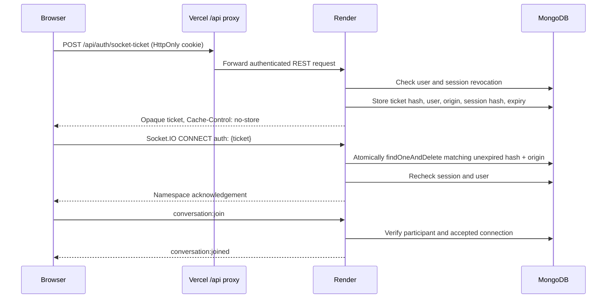

# Socket authentication on free Vercel and Render URLs

Implemented locally on 1 November 2026. **Not deployed.** The user confirmed the production failure: REST authentication succeeds through the frontend proxy, while the direct Render socket has no session cookie and rejects the namespace with `44`.

## Selected architecture

REST remains at `https://roomeematch.vercel.app/api`, proxied to Render. Socket.IO remains directly connected to `https://roomiematch-f8lz.onrender.com/socket.io/`. No custom domain, WebSocket rewrite, Redis, new package, or browser-readable JWT is needed.



Tickets use 32 cryptographically random bytes encoded as 43 base64url characters. MongoDB stores only their SHA-256 hashes, using `_id` for unique indexed lookup. The record binds the ticket to the authenticated user, issuing frontend origin, hashed session identifier, and JWT expiration. Its lifetime is the smaller of **30 seconds** and the remaining session lifetime. A successful `findOneAndDelete` consumes it atomically; the consume operation and session revocation use majority write concern. One caller wins concurrent consumption, including across server processes. Database errors fail closed.

The consume predicate checks both expiry dates explicitly. TTL indexes clean up unused tickets and expired revocations; they are not relied upon for authorization because [MongoDB TTL deletion is asynchronous](https://www.mongodb.com/docs/manual/core/index-ttl/). The [atomic delete operation](https://www.mongodb.com/docs/manual/reference/method/db.collection.findoneanddelete/) removes and returns a single matching record. Startup initializes both new models and their indexes.

## Ticket and session lifecycle

1. The browser sends authenticated `POST /api/auth/socket-ticket` with `{}` through the existing Axios client and REST proxy. The existing custom verification header, JSON requirement, exact-origin CORS policy and HttpOnly session authentication apply. The endpoint additionally requires an allowlisted `Origin`, checks session revocation, rate-limits requests and returns `Cache-Control: no-store`.
2. The client fetches a **new** ticket inside Socket.IO's [`auth` callback](https://socket.io/docs/v4/client-options/#auth), which runs for each namespace connection. Tickets are never cached in browser storage or put in a URL. The JWT remains exclusively in the existing HttpOnly cookie.
3. Socket middleware requires an allowlisted handshake Origin and a valid ticket in `socket.handshake.auth.ticket`. There is no cookie or query-string fallback. It atomically consumes the origin-bound ticket, rechecks the session, loads the user, and derives `socket.data.userId` from MongoDB. Client-supplied user IDs do not choose an identity. A ticket issued for B authenticates B, never a claimed A; it does not grant access to A's private conversation. Tickets are bearer credentials, protected by TLS, short lifetime and one-use semantics.
4. A session room is joined and session validity is checked again to cover logout racing with the handshake. Application events wait for this check. Existing conversation membership, accepted-connection, persistence and deduplication logic remain mandatory and unchanged.
5. Transport reconnects use a new auth callback and therefore a fresh ticket. Namespace rejection due to an expired/consumed ticket gets at most two automatic fresh-ticket retries. Temporary issuance/backend failures get at most ten retries with exponential delays capped at 30 seconds; HTTP 429 waits 60 seconds. HTTP 401/403 stops issuance retries. Pending requests are aborted on transport closure or logout; stale completions cannot reconnect an old socket.
6. Logout persists a session-hash revocation until JWT expiry, deletes outstanding tickets, clears the existing cookie and disconnects that session's sockets. REST authentication checks this revocation too, so replaying the old cookie cannot mint new tickets. New login JWTs include a random `jti` so two logins in the same second remain separate sessions. Existing valid pre-change JWTs continue to work until expiry or logout.
7. Live sockets check session validity before application events, disconnect at JWT expiry, and periodically check durable revocations. Logout disconnects all tabs on the current server immediately; a BroadcastChannel tells other frontend tabs to refresh their REST session. The channel sends only the string `logout`. Socket authentication failures and account changes dispose the old client and clear buffered sends.

The rate limits are 120 ticket requests per minute per IP and 30 per minute per authenticated user. They use the existing express-rate-limit dependency and in-memory stores, appropriate to the current single Render instance. Atomic ticket consumption and session revocation are Mongo-backed and survive process restarts. If adding multiple backend instances, rate limiting needs a shared store and existing conversation rooms/presence need a shared adapter; passive sockets on another instance observe revocation within 30 seconds, while their next application event checks it immediately. In-flight operations already authorized before logout are not rolled back.

## Changes

| File | Purpose |
| --- | --- |
| `server/src/models/SocketTicket.ts` | Hashed ticket records, user/session/origin binding, TTL index |
| `server/src/models/RevokedSession.ts` | Durable hashed session revocations and TTL index |
| `server/src/services/socketTicketService.ts` | Issue, atomically consume, check sessions and revoke |
| `server/src/services/authService.ts` | Verified session metadata, cookie extraction, unique login JWT IDs |
| `server/src/middleware/authenticate.ts` | Reject revoked REST sessions and attach verified session metadata |
| `server/src/controllers/authController.ts` | Ticket endpoint and logout revocation/disconnection |
| `server/src/routes/authRoutes.ts` | Authenticated ticket POST route |
| `server/src/middleware/requestSecurity.ts` | IP and user issuance limits |
| `server/src/config/database.ts` | Initialize new models/indexes before accepting traffic |
| `server/src/realtime/socketServer.ts` | Ticket-only namespace authentication, live session checks and expiry cleanup |
| `client/src/services/socketTicketAuth.ts` | Fresh-ticket auth callback, bounded retries, cancellation |
| `client/src/services/socket.ts` | Use REST ticket requests; close stale sockets and notify session changes |
| `client/src/components/AuthProvider.tsx` | Logout/auth-failure disposal and cross-tab session refresh |
| `client/.env.example`, `server/.env.example` | Correct deployed URLs; document direct socket configuration |
| `server/test/socketTickets.test.ts` | Integration security tests using real disposable MongoDB |
| `server/test/socketTicketClient.test.ts` | Retry/cancellation/lifecycle regressions |
| `server/test/conversations.test.ts`, `messageDeduplication.test.ts` | Existing tests now authenticate through the ticket endpoint |
| `server/test/browserRealtime.mjs` | Actual Chrome/Brave cross-host, reconnect and logout tests |
| `docs/realtime-investigation.md` | Mark previous diagnostic report as historical |
| `docs/socket-ticket-authentication.md` | This design and deployment runbook |

The prior diagnostic patch remains in the workspace: `socketDiagnostics.ts`, server `diagnostics.ts`, diagnostic hooks, connection-error UI handling in `MessagesPage.tsx`, and diagnostic tests. Their logs omit credentials and packet bodies. Do not enable generic Socket.IO packet/payload debug logging, which can include authentication payloads. The implementation adds no dependencies and does not edit `server/.env`, CORS allowlists in live hosting, JWT storage policy, message schemas/indexes, typing or read-receipt logic.

## Validation

- Full `npm test`: **161 passed, 0 failed**, including all existing tests. The original tests were adapted at their socket-client helper to mint tickets rather than attach cookies to WebSocket requests.
- Focused ticket security suite: **11 passed** covering valid/missing/invalid/expired/replayed/query-only tickets, atomic concurrent consumption, origin binding, another user's claimed identity and unauthorized room access, fresh reconnects/multiple tabs, logout and REST revocation, session expiry, issuance safeguards/rate limiting, and server-instance restart.
- Client lifecycle suite: **5 passed** covering fresh tickets, cancellation on logout and transport closure, bounded expiry retries, terminal HTTP 401/403 and rate-limit backoff.
- Actual headless **Chrome and Brave passed** with isolated profiles and disposable local MongoDB: frontend-only cookie, direct socket on another host, intentionally expired first ticket and successful fresh retry, two-user delivery in mounted UIs without refreshing, unauthorized room rejection, multiple tabs, duplicate sends, new tickets after forced transport interruption, and logout across tabs. No page JavaScript errors were observed. Both are Chromium-based; Firefox/WebKit and production HTTPS/Partitioned-cookie behavior were not tested.
- `npm run typecheck` and `npm run lint`: passed.
- `npm run build`: both client and server production builds passed. Vite reports the pre-existing client bundle-size warning (over 500 kB); it does not prevent building.

The first full suite exposed a presence-timing regression; this was fixed before the passing run. A subsequent verification run hit a temporary MongoDB port collision in the existing matching-test setup and was rerun. No production accounts, browser profiles, messages or database records were used in testing.

Repeat the browser tests with an installed Playwright module and installed browser binaries:

```sh
PLAYWRIGHT_MODULE=/absolute/path/to/playwright/index.mjs node --import tsx server/test/browserRealtime.mjs
```

If Playwright is resolvable from the project, omit `PLAYWRIGHT_MODULE`. The script defaults to installed macOS Chrome and Brave; override `CHROME_PATH` and `BRAVE_PATH` on another machine. It uses a dedicated local Vite port, avoids the existing development server, and tears down its temporary servers and database.

## Deployment instructions — operator actions, not performed

No new environment variables or ticket secret are required. The backend must retain its existing JWT secret; generating a different secret invalidates existing sessions.

1. Review and commit the patch. Run `npm test`, `npm run typecheck`, `npm run lint`, `npm run build` from the repository root. Coordinate backend and frontend deployment: the new backend requires tickets, so cached old clients must reload. Old cookie-only clients will be rejected during the transition.
2. In the existing Render service, confirm these settings without copying secrets into logs or chat:

   ```dotenv
   NODE_ENV=production
   CLIENT_ORIGIN=https://roomeematch.vercel.app
   COOKIE_SAME_SITE=none
   REALTIME_DEBUG=false
   ```

   Keep the existing `MONGODB_URI`, `JWT_SECRET`, `JWT_EXPIRES_IN_SECONDS` and Render-assigned `PORT`. `COOKIE_SAME_SITE=none` preserves the current configuration; cookies remain Secure, HttpOnly and host-only. Build command: `npm install && npm run build -w server`. Start command: `npm run start -w server`. Deploy the backend commit first and wait for `GET https://roomiematch-f8lz.onrender.com/api/health` to return 200. The Atlas database user needs create-collection/index and read/write/delete permissions for `sockettickets` and `revokedsessions`, as well as the existing collections. Startup initializes indexes; no data migration is required.
3. In the existing Vercel project, set production build variables:

   ```dotenv
   VITE_API_BASE_URL=/api
   VITE_SOCKET_URL=https://roomiematch-f8lz.onrender.com
   VITE_REALTIME_DEBUG=false
   ```

   Keep the existing project root/build settings and `/api/:path*` rewrite to Render. For the repository-root configuration, the build command is `npm run build -w client` and output directory is `client/dist`. Redeploy the same commit after the backend is healthy; Vite variables are embedded at build time. The client never relies on Vercel's `/socket.io` rewrite. Do not route the socket to Vercel or change REST to direct Render requests.
4. Open the deployed frontend and hard-reload old tabs. Existing unrevoked REST sessions can mint tickets; re-login if the REST session has expired. Verify the endpoint response is not cached. In MongoDB, verify `sockettickets` and `revokedsessions` each have an `expiresAt_1` index with `expireAfterSeconds: 0`; do not inspect/copy credential values.
5. If detailed diagnostics are needed, temporarily use the existing `REALTIME_DEBUG=true` on Render and rebuild Vercel with `VITE_REALTIME_DEBUG=true`. These custom diagnostics omit tickets/JWTs/message contents. Disable both and redeploy after verification.

## Exact manual acceptance checks

1. In Chrome open `https://roomeematch.vercel.app`, sign in normally, and open DevTools before navigating to Messages. Confirm `/api/auth/me` is 200. Confirm `POST /api/auth/socket-ticket` goes to the **frontend** origin, returns 200 and `Cache-Control: no-store`. Its body contains only an opaque `ticket` and `expiresAt`. Do not copy or publish either the ticket or session cookie.
2. Select the newest WebSocket request to **Render**. Its URL must not contain a ticket. Expect incoming Engine.IO `0`, outgoing Socket.IO `40` with an auth ticket, then incoming `40` namespace acknowledgement. Missing Render cookies must no longer cause rejection. Inspect only packet types when recording results.
3. Sign in as a different accepted participant in Brave. Open the same conversation in both browsers. Verify `conversation:joined` in each, send one unique message from Chrome, and confirm one sender bubble plus one recipient bubble **without refreshing**. Reply from Brave. Check read receipts, typing, presence and conversation-list updates.
4. Open a second Chrome tab for the same user. Each namespace connection must issue a different ticket. Send one message and verify each open chat displays it exactly once. Duplicate/replayed ticket and message-idempotency checks are covered by the automated suite; avoid manually replaying credentials in production.
5. Switch DevTools networking offline and then online. Observe a new ticket POST before the next namespace acknowledgement, a new socket ID and conversation rejoin. Send again in both directions without refreshing. Restart the Render service during an agreed test window and repeat this check after it becomes healthy.
6. Log out in one Chrome tab. Both Chrome tabs must leave the authenticated UI and their sockets must disconnect. Brave's different session must remain connected. The old session must no longer issue tickets; test this with the automated fixture rather than copying production cookies. A fresh login must reconnect normally.
7. With a third user who is not a conversation participant, verify access/join is rejected. Ticket authentication must not bypass membership or accepted-connection checks. Expiry, consumed-ticket replay, concurrent consumption and expired-session rejection are enforced by the automated security suite; do not shorten production session duration just to run those tests.

Only claim production success after completing these checks on the deployed commit. Roll back frontend and backend together if needed; rolling back the backend also removes the new session-revocation enforcement, so previously revoked cookies could become usable again until their original JWT expiry.
